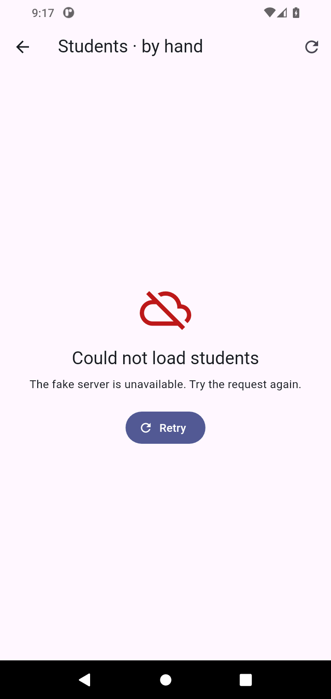
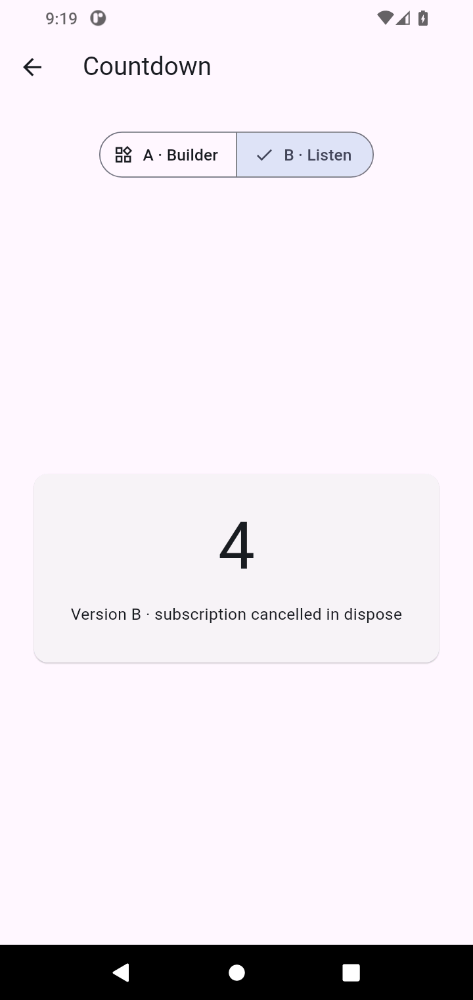

# Practice 10 · The Data Arrives Later

A Flutter lab about delayed data, widget lifetime, stored Futures, stream ownership, and visible asynchronous errors. The home screen opens three implementations: **By hand**, **FutureBuilder**, and **Countdown**.

## Run

```powershell
flutter pub get
flutter run
```

To target the provided Android emulator explicitly:

```powershell
flutter emulators --launch Practice7_API30
flutter run -d emulator-5554
```

## What is implemented

- `FakeApi.fetchStudents()` waits two seconds, counts calls, and throws `NoConnectionException` on every third request.
- `FakeApi.save()` waits one second and rejects every second call with `StateError`.
- The manual screen owns `_students`, `_error`, and `_saving`, checks `mounted` after each await, and renders loading, error, empty, or data views.
- The FutureBuilder screen stores its Future in State. Only Retry replaces it, so rebuilding with the Compact switch does not fetch again.
- Countdown A delegates subscription ownership to `StreamBuilder`; countdown B owns a `StreamSubscription` and cancels it in `dispose`.
- Save is awaited, catches `StateError`, checks `mounted`, disables itself in flight, and pops only on success.
- `unawaited_futures: true` is enabled in `analysis_options.yaml`.

## Screenshots

| Deterministic third-request error | Countdown B mid-count |
| --- | --- |
|  |  |

Both PNG files were captured from the running Android application.

## Verification

```powershell
dart format .
flutter analyze
flutter test
flutter build apk --debug --target-platform android-x64
```

Seven automated tests cover the fake API, the manual views, the empty response, and the stored Future. Android checks also confirmed:

- three sequential manual requests produce the error screen and Retry restores the list;
- ten Compact changes leave the console at one fetch;
- leaving countdown B stops the tick count immediately (8 lines at Back and 8 lines four seconds later);
- a fast double Save sends one request; success pops, while the next save failure stays on screen and shows `server rejected 6`;
- leaving during a pending fetch produces no unhandled or after-dispose error.

The deliberate broken experiments and their exact observations are recorded in [NOTES.md](NOTES.md). They are documented rather than left in the final source.
