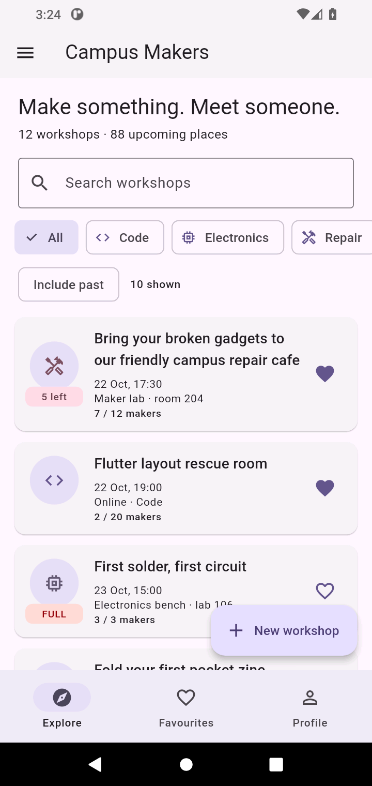
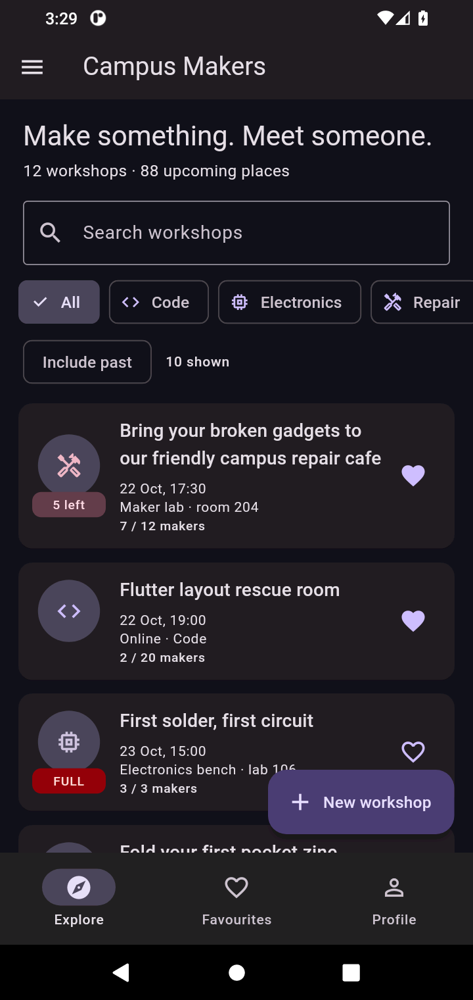
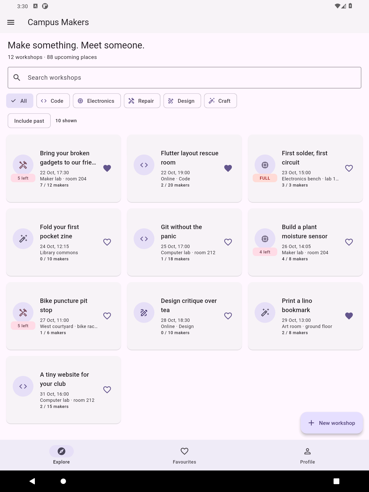

# Campus Makers

A campus workshop club: students share repair, electronics, coding, design and craft skills. Browse twelve workshops, keep favourites, join or leave with your profile name, and create or edit a workshop. A workshop can take place in a room or online; the mode changes both the place label and its validation. Everything lives in memory and resets when the process restarts.

## Run

Built with Flutter 3.47.6 / Dart 3.13.5. Only the Flutter SDK and `flutter_lints` are declared dependencies.

```sh
flutter pub get
flutter run
```

For Android, use an emulator or device. The project also includes Web and Windows runners.

## Screenshots

| Phone · light | Phone · dark | Tablet · grid |
| --- | --- | --- |
|  |  |  |

These are captures of the running Android application, not design mockups.

## Structure

- `lib/models/`: immutable `Workshop` and `Profile`, enhanced category enum, sealed `Countdown`.
- `lib/data/seed.dart`: twelve original workshops, dated relative to the day the app starts or data is reset.
- `lib/utils/format.dart`: date and time formatting without packages.
- `lib/main.dart`: theme state and the single `MaterialApp` / Navigator.
- `lib/routes.dart`: route constants, typed arguments, route factories, unknown-route fallback.
- `lib/screens/shell_screen.dart`: the shared state, NavigationBar, Drawer and route callers.
- `lib/screens/workshop_list_tab.dart`: search, category and past filters, copied sorting, list/grid layout; reused for favourites.
- `lib/screens/detail_screen.dart`: asset header, one-minute timer, About/Makers tabs and membership/edit/delete actions.
- `lib/screens/workshop_form_screen.dart`: new/edit form, validation, picker cancellation, dirty snapshot, simulated asynchronous save.
- `lib/screens/profile_tab.dart`: profile controllers, RegExp group validation and theme chips.
- `lib/widgets/`: reusable workshop card and shared empty state.

## Seed cases

The first title is exactly 60 characters: `Bring your broken gadgets to our friendly campus repair cafe`. `First solder, first circuit` has all three places taken; the poster and keyboard workshops are in the past. `Flutter layout rescue room` and `Design critique over tea` are online. `Fold your first pocket zine` has a null description and an empty makers list. Three workshops start as favourites. Dates are generated from `DateTime.now()` rather than hard-coded calendar dates.

## Decisions

The shell owns the workshop list and profile, passes snapshots down, and receives changes through callbacks. Detail takes callbacks so a membership, edit or deletion updates the same source of truth used by all three tabs. The form returns a `Workshop` through `Navigator.pop`, so its caller can ignore a cancelled route and apply a successful result only after checking `mounted`. The grid uses `LayoutBuilder` because its available box width determines the breakpoint and cells, rather than a global screen size. `PopScope` compares a record of the current field strings, category, mode, date and time with the record captured when the form opened, so undoing edits also clears the dirty flag. A private const workshop constructor plus a public factory that defensively copies the names list preserves immutability, while `Workshop.empty()` supplies date-dependent defaults and `Profile.empty()` is const. With week 9's storage tools I would move loading and saving into a repository, introduce stable participant IDs and persist profile and theme preferences instead of keeping all data in shell state.

## Verification and defence

```sh
dart format .
flutter analyze
flutter build apk --debug
```

No test suite is included, as requested by the lab. See [manual checks](docs/manual_checks.md) for the emulator checks and [requirement map](docs/requirements.md) for where to find each part during the defence. The history contains incremental commits named for the changes they introduce.

The banner is an original geometric illustration generated by `tool/make_banner.ps1`; its PNG is declared in `pubspec.yaml`. No external image service, package, network request or storage is used by the app.
